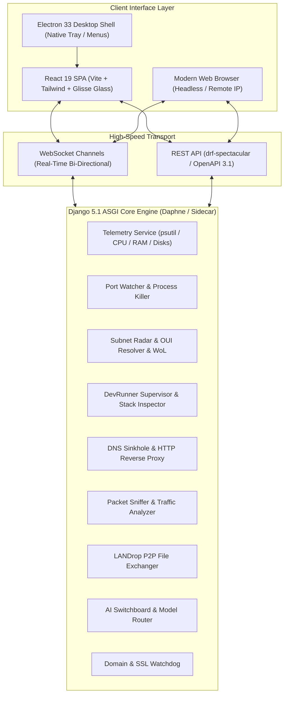
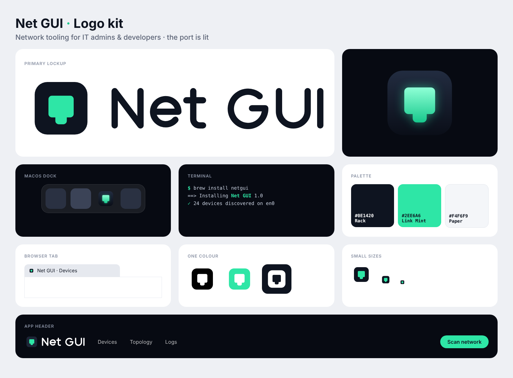

<p align="center">
  <picture>
    <source media="(prefers-color-scheme: dark)" srcset="brand/netgui-horizontal-dark.svg">
    
  </picture>
</p>

<p align="center">
  <strong>Network Radar & Developer Cockpit Suite</strong>
</p>

<p align="center">
  <a href="https://www.python.org/"></a>
  <a href="https://www.djangoproject.com/"></a>
  <a href="https://react.dev/"></a>
  <a href="https://www.typescriptlang.org/"></a>
  <a href="https://vitejs.dev/"></a>
  <a href="https://www.electronjs.org/"></a>
  <a href="https://tailwindcss.com/"></a>
  <a href="LICENSE"></a>
</p>

**Net GUI** is a high-performance local network intelligence platform, developer orchestrator, and real-time observability suite. Engineered with an asynchronous **Django 5.1 ASGI** backend, high-frequency **WebSockets (Django Channels + Daphne)**, and a modern **Liquid Glass (Glisse)** UI built on **React 19**, Net GUI operates seamlessly across:

1. **macOS Desktop Application** (universal `.dmg` with native titlebars, traffic lights, system tray & PyInstaller ASGI sidecar)
2. **Windows Desktop Application** (self-contained `.exe` NSIS installer with system tray and background sidecar)
3. **Headless Linux Server** (systemd service or Docker daemon providing browser access on `http://<ip>:8000`)
4. **Local Fullstack Development** (Vite HMR on `:5173` with Daphne ASGI on `:8000`)

---

## 📑 Table of Contents

- [Overview & Architecture](#-overview--architecture)
- [Key Features & Modules](#-key-features--modules)
- [Tech Stack](#-tech-stack)
- [Brand Identity & Design System](#-brand-identity--design-system)
- [Prerequisites](#-prerequisites)
- [Quick Start](#-quick-start)
- [Running & Build Instructions](#-running--build-instructions)
  - [Fullstack Development Mode](#1-fullstack-development-mode)
  - [Frontend Build](#2-frontend-build)
  - [Compiling Python ASGI Sidecar Binary](#3-compiling-python-asgi-sidecar-binary)
  - [macOS Desktop Packaging (.dmg)](#4-macos-desktop-packaging-dmg)
  - [Windows Desktop Packaging (.exe)](#5-windows-desktop-packaging-exe)
  - [Docker & Container Deployment](#6-docker--container-deployment)
  - [Headless Linux Server Installation (systemd)](#7-headless-linux-server-installation-systemd)
- [API & WebSocket Specification](#-api--websocket-specification)
- [Testing](#-testing)
- [Project Directory Structure](#-project-directory-structure)
- [Configuration & Environment Variables](#-configuration--environment-variables)
- [License](#-license)

---

## 🏛 Overview & Architecture

Net GUI bridges low-level operating system network internals (sockets, routing tables, ARP cache, process PID trees) with a high-performance web dashboard.



---

## ⚡ Key Features & Modules

### 1. 📊 SystemMonitor
- High-frequency CPU, RAM, disk I/O, and per-interface network throughput graphs.
- Live active process tree with CPU/memory footprint breakdown and kill-switch capability.
- Auto-reconnecting WebSocket telemetry stream.

### 2. 🔌 LocalPorts
- Real-time enumeration of all listening TCP/UDP sockets.
- Process correlation: reveals PID, executable path, process name, and launch arguments.
- One-click **Kill Process / Free Port** action.

### 3. 📡 NetworkRadar
- Local subnet discovery: sweeps active subnets (`/24`, `/16`) using multithreaded ARP and ping probes.
- **Hardware OUI database**: resolves MAC addresses to manufacturer names (Apple, Cisco, Espressif, Raspberry Pi, etc.).
- **Wake-on-LAN (WoL)**: constructs and broadcasts IEEE 802.3 magic packets to wake sleeping devices.
- **Continuous Ping Benchmark**: measures real-time latency, jitter, and packet loss against gateway, Cloudflare (1.1.1.1), and Google (8.8.8.8).

### 4. 🕵️ APISniffer
- In-flight HTTP/HTTPS and WebSocket payload inspection.
- Request/response header analysis, status code metrics, and latency percentiles.

### 5. 📦 LANDrop (AirDrop for Any Network)
- Zero-configuration local network peer discovery.
- Drag-and-drop secure file transfers between devices without cloud relays.

### 6. 🚀 DevRunner
- Process supervisor for microservices, fullstack projects, and background jobs.
- Automated tech stack detection (Django, FastAPI, Node, Next.js, Go, Rust).
- Integrated SQLite / PostgreSQL schema viewer.
- Environment variable vault (`.env` manager with security masking).
- Cloud deployment hooks (Vercel, Railway, Docker, Fly.io).

### 7. 🛡️ VpnGateway & DNS Sinkhole
- Built-in DNS sinkhole for network-wide telemetry and tracker blocking.
- HTTP / SOCKS5 local reverse proxy with customizable domain rerouting.

### 8. 🧠 AISwitchboard
- Multi-provider AI model routing (Claude, GPT, Gemini, Local LLMs).
- Latency profiling, token usage tracking, and cost optimization metrics.

### 9. 🐕 DomainWatchdog
- Continuous domain uptime monitor.
- SSL/TLS certificate expiration countdown and validity alerts.
- Global DNS propagation check (A, AAAA, CNAME, MX, TXT).

### 10. 🧊 Glisse UI System
- Custom liquid glass aesthetic with backdrop blurs, glow effects, and responsive navigation.

---

## 🛠 Tech Stack

| Layer | Technologies |
|---|---|
| **Frontend** | React 19, TypeScript 5.7, Vite 6, Tailwind CSS 3.4, Lucide Icons |
| **Backend** | Python 3.10+, Django 5.1 (ASGI), Channels 4.1, Daphne 4.1, DRF, WhiteNoise |
| **Networking & OS** | psutil, socket, httpx, drf-spectacular (OpenAPI 3.1) |
| **Desktop Shell** | Electron 33, electron-builder 25, PyInstaller 6 |
| **Containers & Deploy** | Docker multi-stage build, docker-compose, systemd unit |

---

## 🎨 Brand Identity & Design System

The Net GUI brand identity is built on a simple concept: **a network port punched into an application tile, illuminated from inside like an active hardware link light**. The tile represents the application interface; the light signifies an active, verified network connection.

<p align="center">
  
</p>

### 🎨 Color Palette

| Color Name | HEX | RGB | Application in Net GUI |
|---|---|---|---|
| **Rack** | `#0E1420` | `rgb(14, 20, 32)` | App tile, dark UI panels, glass cards, wordmark |
| **Link Mint** | `#2EE6A6` | `rgb(46, 230, 166)` | Port light, active links, primary accent, interactive buttons |
| **Paper** | `#F4F6F9` | `rgb(244, 246, 249)` | Light mode background, high-contrast text and surfaces |
| **Night** | `#070A12` | `rgb(7, 10, 18)` | Deep background behind glow icon, dark canvas, OLED black |

### 📁 Brand Assets Directory (`brand/`)

All vector masters, export variants, raster PNGs, and web icons are tracked in the repository under [`brand/`](brand/):

- `brand/netgui-symbol.svg`: Flat master vector mark (Rack tile + Link Mint port)
- `brand/netgui-symbol-cutout.svg`: Single-color cutout vector master
- `brand/netgui-horizontal.svg` & `brand/netgui-horizontal-dark.svg`: Primary horizontal lockups (light & dark)
- `brand/netgui-stacked.svg`: Vertical stacked lockup
- `brand/netgui-app-icon-glow.svg`: Luminous glowing application icon (Dock / Desktop / Hero)
- `brand/png/`: Master 1024px PNG exports
- `brand/web/`: Complete favicon bundle (`favicon.ico`, `favicon.svg`, `apple-touch-icon.png`, `site.webmanifest`)
- `brand/variants/`: Monochrome, black, white, and square avatar variants
- `brand/USAGE-GUIDE.md`: Spacing, minimum sizes, and usage rules

---

## 📋 Prerequisites

Ensure your host system meets the following prerequisites:

- **Node.js**: v18.0.0 or higher (`v20+` recommended)
- **npm**: v9.0.0 or higher
- **Python**: v3.10, v3.11, v3.12, or v3.13
- **Git**

---

## 🚀 Quick Start

To launch the complete development environment with one command:

```bash
# Clone the repository
git clone https://github.com/idwnis/net-gui.git
cd net-gui

# One-click start script: automatically initializes venv, installs requirements,
# applies database migrations, installs frontend packages, and boots both servers
bash start.sh
```

Once started:
- 🖥 **Frontend Web UI**: [http://localhost:5173/](http://localhost:5173/)
- 🔌 **Django ASGI API**: [http://127.0.0.1:8000/api/health/](http://127.0.0.1:8000/api/health/)
- 📖 **Interactive Swagger UI**: [http://127.0.0.1:8000/api/docs/](http://127.0.0.1:8000/api/docs/)

---

## 🔨 Running & Build Instructions

### 1. Fullstack Development Mode

You can run individual parts or use the root workspace npm scripts:

#### Root Scripts
```bash
npm run dev              # Executes bash start.sh (both backend and frontend)
npm run dev:frontend     # Runs only the Vite dev server on port 5173
```

#### Manual Backend Setup
```bash
cd backend
python3 -m venv venv
source venv/bin/activate       # On Windows: .\venv\Scripts\activate
pip install --upgrade pip
pip install -r requirements.txt
python manage.py migrate

# Start Daphne ASGI server
daphne -b 0.0.0.0 -p 8000 config.asgi:application
```

#### Manual Frontend Setup
```bash
cd frontend
npm install
npm run dev
```

---

### 2. Frontend Build

Compiles the React TypeScript single-page application into production static assets:

```bash
npm run build:frontend
# or: cd frontend && npm run build
```

Production output is generated at `frontend/dist/`.

---

### 3. Compiling Python ASGI Sidecar Binary

Net GUI Desktop packages the Django backend into a standalone native binary without requiring end-users to have Python installed:

```bash
# Compiles backend using PyInstaller into desktop/sidecar/netpulse-core
npm run sidecar:build
```

Script reference: [`scripts/build_sidecar.py`](scripts/build_sidecar.py).

---

### 4. macOS Desktop Packaging (.dmg)

Produces a signed or ad-hoc macOS Universal DMG installer containing the native Electron shell and the ASGI sidecar:

```bash
# 1. Build frontend
npm run build:frontend

# 2. Build backend sidecar
npm run sidecar:build

# 3. Package macOS DMG
npm run desktop:build:mac
```

Output:
- `desktop/dist/Net GUI-2.0.0-mac-universal.dmg` (supports Apple Silicon M1-M4 and Intel x86_64)

To run the desktop app locally in development:
```bash
npm run desktop:start
```

---

### 5. Windows Desktop Packaging (.exe)

On a Windows build machine or cross-compilation environment:

```bash
# 1. Build frontend
npm run build:frontend

# 2. Build Windows sidecar
python scripts/build_sidecar.py

# 3. Package Windows NSIS installer
npm run desktop:build:win
```

Output:
- `desktop/dist/Net GUI-2.0.0-win-x64.exe`

---

### 6. Docker & Container Deployment

Net GUI includes a multi-stage Dockerfile that builds the React frontend and executes the Django ASGI daemon inside a lightweight Linux container.

#### Using Docker Compose (Recommended)

```bash
docker-compose up -d --build
```

Services exposed:
- `8000`: Web Dashboard & REST/WebSocket API
- `7890`: HTTP/SOCKS5 VPN Gateway Proxy
- `53`: DNS Sinkhole (UDP & TCP)

View container logs:
```bash
docker-compose logs -f netpulse
```

Stop container:
```bash
docker-compose down
```

---

### 7. Headless Linux Server Installation (systemd)

For dedicated Ubuntu, Debian, Rocky, RHEL, or Arch servers:

```bash
sudo bash deploy/linux_setup.sh
```

This automated script:
1. Installs system packages (`python3-venv`, `lsof`, `curl`, `net-tools`).
2. Creates an unprivileged system user `netpulse`.
3. Deploys application code to `/opt/netpulse`.
4. Configures database storage in `/var/lib/netpulse`.
5. Installs and starts `/etc/systemd/system/netpulse.service`.

Manage the service:
```bash
sudo systemctl status netpulse
sudo systemctl restart netpulse
sudo journalctl -u netpulse -f
```

---

## 📡 API & WebSocket Specification

### REST Endpoints

| Category | Endpoint | Method | Description |
|---|---|---|---|
| **Health** | `/api/health/` | `GET` | Service status, engine version & runtime health |
| **Documentation** | `/api/docs/` | `GET` | Interactive OpenAPI 3.1 Swagger UI |
| **Schema** | `/api/schema/` | `GET` | Raw OpenAPI 3.1 YAML/JSON schema |
| **Telemetry** | `/api/telemetry/metrics/` | `GET` | Snapshot of CPU, memory, disks & interfaces |
| **Ports** | `/api/ports/` | `GET` | List listening ports and bound processes |
| **Ports** | `/api/ports/kill/` | `POST` | Terminate process by PID or port number |
| **Radar** | `/api/radar/devices/` | `GET` | Active LAN devices, vendors & IP mappings |
| **Radar** | `/api/radar/scan/` | `POST` | Trigger asynchronous subnet ARP/ping sweep |
| **Radar** | `/api/radar/wol/` | `POST` | Dispatch Wake-on-LAN magic packet |
| **Radar** | `/api/radar/ping-targets/` | `GET/POST` | Ping latency & jitter benchmark targets |
| **Runner** | `/api/runner/services/` | `GET/POST` | Manage background services and projects |
| **Gateway** | `/api/gateway/stats/` | `GET` | DNS sinkhole and proxy throughput metrics |
| **Sniffer** | `/api/sniffer/packets/` | `GET` | Inspect captured HTTP/WebSocket network packets |
| **LANDrop** | `/api/landrop/peers/` | `GET` | List available LAN file drop targets |
| **LANDrop** | `/api/landrop/upload/` | `POST` | Upload files for peer-to-peer distribution |
| **Watchdog** | `/api/watchdog/monitors/` | `GET/POST` | Manage domain uptime and SSL monitoring |

### WebSocket Channels

| Protocol Path | Description |
|---|---|
| `ws://<host>/ws/telemetry/` | High-frequency telemetry stream (CPU %, RAM %, bandwidth KB/s) |
| `ws://<host>/ws/radar/` | Subnet scan progress and newly discovered device events |
| `ws://<host>/ws/runner/logs/<service_id>/` | Real-time console log streaming from managed processes |
| `ws://<host>/ws/gateway/dns/` | Live DNS query stream with sinkhole block flags |
| `ws://<host>/ws/sniffer/` | Real-time packet sniffer feed |
| `ws://<host>/ws/landrop/` | P2P transfer progress and peer discovery broadcasts |

---

## 🧪 Testing

The backend includes a comprehensive unit and integration test suite covering all services, models, and API views:

```bash
# Run all backend tests
npm run test:backend

# Or run directly via Django manage.py
backend/venv/bin/python backend/manage.py test apps.core apps.telemetry apps.ports apps.radar apps.runner apps.gateway apps.sniffer apps.landrop apps.switchboard apps.watchdog
```

To run frontend TypeScript validation:
```bash
npm --prefix frontend run build
```

---

## 📁 Project Directory Structure

```
net-gui/
├── .agents/                 # AI agent configuration & skills
├── .gitignore               # Comprehensive Git ignore rules
├── DEPLOYMENT.md            # Cross-platform deployment guide
├── Dockerfile               # Multi-stage production container build
├── docker-compose.yml       # Production Docker service orchestration
├── package.json             # Root monorepo orchestration scripts
├── start.sh                 # One-click fullstack launch script
│
├── backend/                 # Django 5.1 ASGI Backend Engine
│   ├── apps/
│   │   ├── core/            # OS adapters, base helpers, cross-platform layer
│   │   ├── telemetry/       # System metrics, psutil integrations & WebSockets
│   │   ├── ports/           # Active listening ports & process termination
│   │   ├── radar/           # Subnet scanner, OUI database, Wake-on-LAN
│   │   ├── runner/          # Dev process supervisor, stack detector, db viewer
│   │   ├── gateway/         # DNS sinkhole, HTTP/SOCKS5 proxy
│   │   ├── sniffer/         # Packet inspection & HTTP traffic analyzer
│   │   ├── landrop/         # P2P local file transfer engine
│   │   ├── switchboard/     # AI model switcher & router
│   │   └── watchdog/        # Domain health, SSL expiration & DNS checker
│   ├── config/              # Django settings, ASGI/WSGI, Channels routing & URLs
│   ├── manage.py            # Django management CLI
│   ├── requirements.txt     # Python backend dependencies
│   └── sidecar_entry.py     # Standalone PyInstaller bootstrap entrypoint
│
├── frontend/                # React 19 Frontend SPA
│   ├── src/
│   │   ├── components/      # UI feature modules (Radar, Ports, Monitor, etc.)
│   │   │   └── Glisse/      # Liquid Glass design system components
│   │   ├── context/         # Theme & application context providers
│   │   ├── services/        # REST client & WebSocket manager
│   │   ├── types/           # TypeScript interfaces & types
│   │   ├── App.tsx          # Root dashboard view
│   │   └── main.tsx         # Application entrypoint
│   ├── tailwind.config.js   # Tailwind CSS configuration
│   └── vite.config.ts       # Vite bundler configuration
│
├── desktop/                 # Electron 33 Desktop Shell
│   ├── assets/              # App icons (PNG, SVG)
│   ├── build/               # macOS entitlements & build resources
│   ├── electron-builder.json# Packaging configuration (macOS DMG / Windows NSIS)
│   ├── main.cjs             # Electron main process & sidecar supervisor
│   ├── preload.cjs          # Context bridge & secure IPC preload
│   └── sidecar/             # Location for compiled native ASGI binary
│
├── deploy/                  # Linux server automation scripts
│   └── linux_setup.sh       # systemd automated installer
├── scripts/                 # Build & automation scripts
│   └── build_sidecar.py     # PyInstaller sidecar binary compilation script
└── systemd/                 # Linux daemon definitions
    └── netpulse.service     # Systemd service unit file
```

---

## ⚙️ Configuration & Environment Variables

| Variable | Default | Purpose |
|---|---|---|
| `DJANGO_SECRET_KEY` | *(Auto-generated fallback)* | Secret key used for cryptographic signing |
| `DEBUG` | `False` in prod, `True` in dev | Enables verbose Django debug mode |
| `ALLOWED_HOSTS` | `*` | Comma-separated list of allowed hostnames/IPs |
| `NETPULSE_DATA_DIR` | `backend/data/` or OS User Data | Path where SQLite databases and runtime state are kept |
| `NETPULSE_MEDIA_DIR`| `backend/media/` | Storage location for LANDrop file transfers |
| `PORT` / `BACKEND_PORT` | `8000` | Port for the Daphne ASGI engine |

---

## 📄 License

This project is licensed under the [MIT License](LICENSE).
